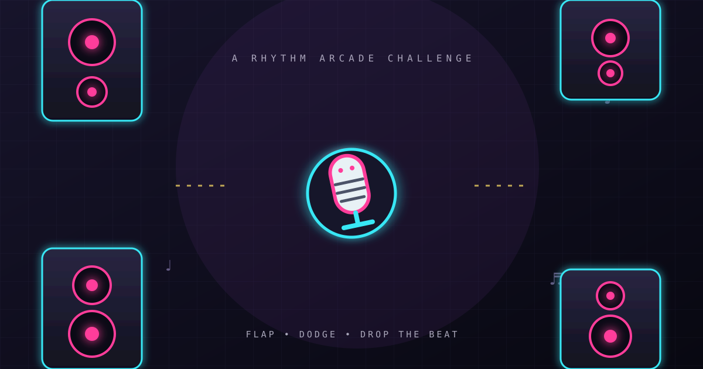

<div align="center">
  

  # Flappy Beat Drop

  **Flap. Dodge. Drop the beat.**

  A neon, rhythm-inspired arcade game built for quick sessions on desktop and mobile.

  [Play the live game](https://golden-elf-10a0d8.netlify.app/) · [Install and offline-play guide](https://golden-elf-10a0d8.netlify.app/install.html)
</div>

## About

Take control of a musical character and weave through glowing speaker stacks. Collect vinyl and temporary power-ups, build score combos, and try to beat your personal best. Flappy Beat Drop is a lightweight, installable browser game made with HTML, CSS, and vanilla JavaScript—no build step or runtime package dependencies required.

## Features

- Three playable characters: MC Mic, Boombox, and Grillz
- Responsive Canvas gameplay with neon, city-inspired visuals
- Endless obstacle course with gradually increasing challenge
- Combo scoring with multipliers up to 4×
- Vinyl bonus pickups, protective Shield, and temporary Slow-Mo
- Synthesized sound effects using the Web Audio API, with a mute toggle
- Personal best stored locally in the browser
- Pause and resume, including automatic pause when the page is hidden
- Touch, pointer, and keyboard controls
- Installable as a home-screen web app, with service-worker app-shell caching
- Reduced-motion preference support

## Play and install

- **Play online:** [Flappy Beat Drop](https://golden-elf-10a0d8.netlify.app/)
- **Install / prepare offline play:** [Open the install guide](https://golden-elf-10a0d8.netlify.app/install.html)

Open the install guide over HTTPS while online. The service worker caches the game shell for offline use. On Android, use the browser's **Install app** option. On iPhone or iPad, open the site in Safari and choose **Share → Add to Home Screen**. Visit once while online before trying to play offline.

## How to play

| Action | Control |
| --- | --- |
| Start / flap | Tap or click the game; press **Space** on desktop |
| Pause / resume | **Esc** or **P**, or use the pause button |
| Toggle sound | Use the sound button in the header |

Fly through each speaker gap without hitting an obstacle or the stage boundary. Clearing obstacles builds your combo; pickups add points or temporary abilities. Some browsers require a user gesture before audio can start.

## Run locally

There are no dependencies to install and no build step. You can open `index.html` directly for basic play. To test service-worker registration and offline caching, serve the repository over localhost (service workers require HTTPS or localhost):

```bash
python -m http.server 8000
```

Then open <http://localhost:8000/>. Visit <http://localhost:8000/install.html> to follow the install and offline setup guide.

## Deploy

This is a static website. Publish the repository root with Netlify, GitHub Pages, Vercel, or another static host; `index.html` is the entry point. The included `netlify.toml` provides Netlify configuration. Serve the site over HTTPS for installation and service-worker features.

After changing cached files, update the cache version in `sw.js` before deployment so returning visitors receive the new app shell. Test the deployed site on a phone and desktop, and verify install/offline behavior after the first online visit.

## Built with

- HTML5 and CSS
- Vanilla JavaScript and the Canvas API
- Web Audio API
- Web App Manifest and Service Worker APIs
- Google Fonts: Space Grotesk and DM Mono

## Project structure

```text
.
├── assets/
│   ├── app-icon.svg          # Installable app icon
│   ├── apple-touch-icon.png  # Apple home-screen icon
│   ├── cover.svg             # README banner artwork
│   ├── icon-192.png          # Manifest icon
│   └── icon-512.png          # Manifest icon
├── .github/
│   └── PULL_REQUEST_TEMPLATE.md
├── CONTRIBUTING.md
├── SECURITY.md
├── favicon.svg
├── index.html                # Game markup, styles, and JavaScript
├── input-fix.js              # Keyboard repeat and control-focus safeguards
├── install.html              # Installation and offline setup guide
├── manifest.webmanifest      # Installable web app metadata
├── netlify.toml              # Netlify deployment configuration
└── sw.js                     # Offline app-shell caching
```

## Privacy

The game has no account system or application backend. Your personal-best score is saved in your browser's local storage. The page imports Google Fonts, which means font requests are made to Google when the font is not already available in the browser cache. No analytics or advertising are included in the game code.

## Contributing

Bug reports, thoughtful feature suggestions, and improvements are welcome. Read [CONTRIBUTING.md](CONTRIBUTING.md) before opening an issue or pull request. Please include the browser/device details and clear steps to reproduce gameplay bugs.

## Security

Please review [SECURITY.md](SECURITY.md) for reporting security concerns.

## License

No license has been specified. All rights are reserved by default; please contact the repository owner before reusing or redistributing this project.
